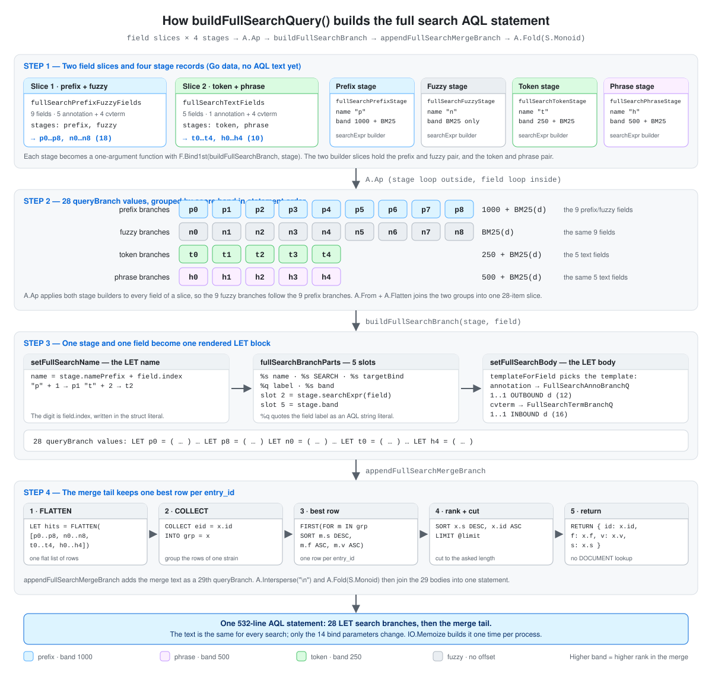

# How the Full Search AQL Statement Is Built

The `SearchAnnotation` method runs one large AQL statement. No file in
this repository holds that statement as finished text. The Go code
assembles it from small parts. This document follows those parts in
order. It shows which piece of Go code makes which piece of AQL.

## Table of Contents

- [What This Document Covers](#what-this-document-covers)
- [The Shape of the Final Statement](#the-shape-of-the-final-statement)
- [Visual Overview of the Build Pipeline](#visual-overview-of-the-build-pipeline)
- [Step 1: The Field Definitions](#step-1-the-field-definitions)
  - [The 6 Prefix Branch Specs and the 5 Fuzzy Branch Specs](#the-6-prefix-branch-specs-and-the-5-fuzzy-branch-specs)
  - [The 5 Text Fields](#the-5-text-fields)
  - [The Two Collections and the Field Selectors](#the-two-collections-and-the-field-selectors)
- [Step 2: The Four Stages and the 21 Branches](#step-2-the-four-stages-and-the-21-branches)
  - [The fullSearchStage Record](#the-fullsearchstage-record)
  - [How the Four Stage Groups Expand](#how-the-four-stage-groups-expand)
  - [The Five SEARCH Expression Builders](#the-five-search-expression-builders)
  - [The Four Score Bands](#the-four-score-bands)
  - [The Full List of 21 Branches](#the-full-list-of-21-branches)
  - [The Tests That Hold the Count, the Bands, and the Order](#the-tests-that-hold-the-count-the-bands-and-the-order)
- [Step 3: From One Stage and One Field to One AQL LET Block](#step-3-from-one-stage-and-one-field-to-one-aql-let-block)
  - [The fullSearchBranchState Record](#the-fullsearchbranchstate-record)
  - [setFullSearchName Writes the Variable Name](#setfullsearchname-writes-the-variable-name)
  - [selectFullSearchBranchParts Fills the Template Slots](#selectfullsearchbranchparts-fills-the-template-slots)
  - [setFullSearchBody Selects the Template and Renders It](#setfullsearchbody-selects-the-template-and-renders-it)
  - [What Each Clause in the Annotation Template Does](#what-each-clause-in-the-annotation-template-does)
  - [What Each Clause in the cvterm Template Does](#what-each-clause-in-the-cvterm-template-does)
- [Step 4: The Merge Block and the Complete Statement](#step-4-the-merge-block-and-the-complete-statement)
  - [appendFullSearchMergeBranch Builds the Tail](#appendfullsearchmergebranch-builds-the-tail)
  - [What Each Clause in the Merge Block Does](#what-each-clause-in-the-merge-block-does)
  - [assembleFullSearchQuery Joins the Parts](#assemblefullsearchquery-joins-the-parts)
  - [IO.Memoize Builds the Statement One Time](#iomemoize-builds-the-statement-one-time)
  - [buildFullSearchQueryParams Attaches the Bind Parameters](#buildfullsearchqueryparams-attaches-the-bind-parameters)
- [The Assembled AQL](#the-assembled-aql)
  - [Branch p0, Combined Prefix on Whole-Value Annotations](#branch-p0-combined-prefix-on-whole-value-annotations)
  - [Branch p1, Prefix on the genotype Value](#branch-p1-prefix-on-the-genotype-value)
  - [Branch n0, Combined Fuzzy on Identifier Annotations](#branch-n0-combined-fuzzy-on-identifier-annotations)
  - [Branch p2, Prefix on the phenotype Label](#branch-p2-prefix-on-the-phenotype-label)
  - [Branch t0, Token on the public_note Value](#branch-t0-token-on-the-public_note-value)
  - [Branch h0, Phrase on the public_note Value](#branch-h0-phrase-on-the-public_note-value)
  - [The Rendered Merge Block](#the-rendered-merge-block)
- [Source Files](#source-files)

## What This Document Covers

This document covers one subject only. That subject is the construction
of the full search AQL text. It explains the Go functions in plain
words, so a reader who does not know the `fp-go` library can follow the
code.

Topics outside this subject are not here. The document does not cover
these parts of the feature:

- The three custom analyzers and the built-in `text_en` analyzer
- The creation of the `annotation_full_search` view and its reconciliation
- The input validation, the limit clamp, and the stopword rule
- The target resolution query `fullSearchTargetsQ`
- The gRPC handler
- The read of the result rows from the database cursor

The glossary below explains in plain words each `fp-go` helper that the
code extracts use. Each helper is a small, ordinary operation with a
functional name.

| Helper | What it does |
|--------|--------------|
| `F.Pipe1` to `F.Pipe6` | Send one value through 1 to 6 functions in order. The result of one function becomes the input of the next. |
| `A.Map(f)` | Apply `f` to every item of a slice. The output slice has the same length. |
| `A.Ap(values)` | Take a slice of functions. Apply every function to every value. The outer loop is the function loop. |
| `A.From(a, b)` | Make a slice from the listed items. |
| `A.Flatten` | Join a slice of slices into one flat slice. |
| `A.Empty[A]()` | Make an empty slice of type `[]A`. |
| `A.Push(x)` | Add `x` to the end of a slice. The result is a new slice, and the input slice does not change. |
| `A.Append(as, x)` | Add `x` to the end of `as`. This form can write into the spare capacity of `as`. |
| `A.Intersperse(sep)` | Put `sep` between every two items of a slice. |
| `A.Fold(S.Monoid)` | Concatenate a slice of strings into one string. With `A.Intersperse` the pair gives the result of `strings.Join`. |
| `P.Fold(onFalse, onTrue)` | Take a yes/no test and two functions. Run `onTrue` when the test says yes, and `onFalse` when it says no. |
| `P.ContraMap(get)` | Move a test onto a larger type. The test runs on the value that `get` reads out of that type. |
| `EQ.Equals(eq)(x)` | Make a test that compares its input with `x`. |
| A lens | A read and write pair for one struct field. `Get` reads the field. `Set(v)` returns a **copy** of the struct with the new value. The code never mutates a struct in place. |
| `L.Compose` | Join two lenses into one lens that reads and writes a nested field. |
| `F.Bind1st(f, x)` | Fix the first argument of a two-argument function. The result takes the second argument only. |
| `F.Flip(f)` | Exchange the two arguments of a curried function. |
| `S.Format(tpl)` | Put one value into a format template. This is `fmt.Sprintf` with the template fixed first. |
| `IO.Memoize(f)` | Wrap a no-argument function. The first call runs `f`. Every later call returns the stored result. |


## The Shape of the Final Statement

The generated statement has two regions.

1. **21 `LET` search branches.** Each branch is an independent
   sub-query over the `annotation_full_search` view. Each branch
   searches one field or combined annotation tag group, keeps at most
   `@limit` rows, and returns a flat row object. The branch variables
   come in four groups: `p0` to `p5`, then `n0` to `n4`, then `t0` to
   `t4`, then `h0` to `h4`.
2. **One merge and rank region.** It collects the rows of all 21
   branches and keeps the best row for each strain `entry_id`. It then
   sorts the survivors and cuts the list to `@limit`.

```
LET p0 = ( ... )     <- branch  1: combined prefix on synonym, systematic_name, genetic_modification, mutagenesis_method
LET p1 = ( ... )     <- branch  2: prefix on the genotype value
...
LET p5 = ( ... )     <- branch  6: prefix on the characteristic label
LET n0 = ( ... )     <- branch  7: combined fuzzy on synonym, genotype, systematic_name
...
LET n4 = ( ... )     <- branch 11: fuzzy  on the characteristic label
LET t0 = ( ... )     <- branch 12: token  on the public_note value
...
LET t4 = ( ... )     <- branch 16: token  on the characteristic label
LET h0 = ( ... )     <- branch 17: phrase on the public_note value
...
LET h4 = ( ... )     <- branch 21: phrase on the characteristic label
LET hits = FLATTEN([p0, ..., h4])
LET best = ( ... )   <- one best row per entry_id
FOR x IN best        <- final sort and final LIMIT
```

The 21 branches stand in band groups. All prefix branches come first,
then all fuzzy branches, then the token branches, then the phrase
branches. The branches never share state. The build code can therefore
treat each branch as one independent value. A reader can also read one
branch without the other 20.

The merge region of this statement reads no document. The branch rows
already carry the 4 attributes that the API returns. A reader who knows
the full search of a sister service must not expect a `DOCUMENT` lookup
here.

## Visual Overview of the Build Pipeline

The diagram below shows the four steps on one page. Read it from the
top to the bottom. Each large row is one step of this document, and the
label on each arrow is the call that performs that step. The colour of
a box is the score band of its branches: blue for prefix, purple for
phrase, green for token, and grey for fuzzy.



- **Step 1** holds three field slices (`fullSearchPrefixFields`,
  `fullSearchFuzzyFields`, `fullSearchTextFields`) and four stage
  records.
- **Step 2** maps the prefix and fuzzy stages over their slices and
  applies the token and phrase builders to the text slice. This gives
  `6` prefix branches (`p0` to `p5`), `5` fuzzy branches (`n0` to `n4`),
  `5` token branches (`t0` to `t4`), and `5` phrase branches (`h0` to
  `h4`).
- **Step 3** runs inside each builder call. It writes the `LET`
  variable name, fills the template slots, and selects one of the two
  branch templates: `OUTBOUND` for the `5` annotation branches, and
  `INBOUND` for the `16` cvterm branches.
- **Step 4** adds the merge tail as a 22nd branch. The tail flattens
  the 21 row lists, groups them by `entry_id`, keeps one best row per
  strain, ranks the survivors, and cuts the list to `@limit`.

## Step 1: The Field Definitions

The build starts from data, not from text. Three slices in
`internal/repository/arangodb/fullsearch_query.go` name the searched
fields. Each entry is a `fullSearchField` with six parts.

| Part | What it holds |
|------|---------------|
| `index` | The 0-based position inside its own stage group. The digit of the `LET` variable comes from this value. |
| `label` | The AQL expression or quoted string literal that the row reports as `f`. |
| `coll` | `fullSearchCollAnno` or `fullSearchCollTerm`. This part selects the indexed attribute and the branch template. |
| `targetBind` | The target cvterm `_id` list (for `e._to IN [...]` on annotation branches) or the bind parameter name of the ontology `graph_id` (on cvterm branches). |
| `valueFilter` | The post-`SEARCH` `FILTER d.value NOT IN [...]` clause on annotation branches. |
| `isGenotype` | `true` for the genotype field only. This part selects the prefix expression. |

### The 6 Prefix Branch Specs and the 5 Fuzzy Branch Specs

Because `annotation` documents do not store their tag directly, scanning
`d.value` separately for each tag repeats the same `ArangoSearch` view
scan and `OUTBOUND` graph traversal multiple times. `fullSearchPrefixFields`
therefore combines the four whole-value prefix annotation tags
(`synonym`, `systematic_name`, `genetic_modification`, and
`mutagenesis_method`) into one branch `p0`, keeps `genotype` (which uses
both the norm and delimiter analyzers) in `p1`, and lists the four
ontology `cvterm` fields in `p2` to `p5`.

`fullSearchFuzzyFields` combines the three identifier annotation tags
(`synonym`, `genotype`, and `systematic_name`) into one fuzzy branch
`n0`, omits `genetic_modification` and `mutagenesis_method` (which hold
fixed controlled-vocabulary strings shared across tens of thousands of
strains), and lists the four ontology `cvterm` fields in `n1` to `n4`.

| Prefix Var | Fuzzy Var | Field / Group | Collection | Target Bind |
|------------|-----------|---------------|------------|-------------|
| `p0` | — | `synonym`, `systematic_name`, `genetic_modification`, `mutagenesis_method` | annotation | `@synonym_term_id, @sysname_term_id, @muttype_term_id, @mutmethod_term_id` |
| `p1` | — | `genotype` | annotation | `@genotype_term_id` |
| — | `n0` | `synonym`, `genotype`, `systematic_name` | annotation | `@synonym_term_id, @genotype_term_id, @sysname_term_id` |
| `p2` | `n1` | `phenotype` | cvterm | `@phenotype_graph_id` |
| `p3` | `n2` | `environment` | cvterm | `@env_graph_id` |
| `p4` | `n3` | `assay` | cvterm | `@assay_graph_id` |
| `p5` | `n4` | `characteristic` | cvterm | `@char_graph_id` |

### The 5 Text Fields

`fullSearchTextFields` holds the fields that the English text analyzer
indexes. Each field gets a token branch `t<index>` and a phrase branch
`h<index>`.

| Index | Label | Collection | Target bind parameter |
|-------|-------|------------|-----------------------|
| 0 | `public_note` | annotation | `@pubnote_term_id` |
| 1 | `phenotype` | cvterm | `@phenotype_graph_id` |
| 2 | `environment` | cvterm | `@env_graph_id` |
| 3 | `assay` | cvterm | `@assay_graph_id` |
| 4 | `characteristic` | cvterm | `@char_graph_id` |

### The Two Collections and the Field Selectors

Package variables resolve every field-dependent value through `P.Fold`:

- `docAttrForField`: selects `"value"` for annotation fields and `"label"` for cvterm fields.
- `templateForField`: selects `FullSearchAnnoBranchQ` for annotation fields and `FullSearchTermBranchQ` for cvterm fields.
- `prefixExprForField`: selects `genotypeFullSearchPrefixExpr` when `isGenotype` is true, and `standardFullSearchPrefixExpr` otherwise.
- `selectFullSearchBranchParts`: selects `annoFullSearchBranchParts` (6 slots) or `termFullSearchBranchParts` (5 slots).

## Step 2: The Four Stages and the 21 Branches

### The fullSearchStage Record

A `fullSearchStage` is the complete plan of one search kind:

| Stage variable | Name prefix | Expression builder | Band constant |
|----------------|-------------|--------------------|---------------|
| `fullSearchPrefixStage` | `p` | `prefixExprForField` | `fullSearchPrefixBand` |
| `fullSearchFuzzyStage` | `n` | `fuzzyExprForField` | `fullSearchFuzzyBand` |
| `fullSearchTokenStage` | `t` | `tokenExprForField` | `fullSearchTokenBand` |
| `fullSearchPhraseStage` | `h` | `phraseExprForField` | `fullSearchPhraseBand` |

### How the Four Stage Groups Expand

`assembleFullSearchQuery` maps `fullSearchPrefixStage` over the 6
`fullSearchPrefixFields` (`p0` to `p5`), maps `fullSearchFuzzyStage`
over the 5 `fullSearchFuzzyFields` (`n0` to `n4`), and uses `A.Ap` to
apply `tokenPhraseBranchBuilders` across the 5 `fullSearchTextFields`
(`t0` to `t4`, then `h0` to `h4`).

### The Five SEARCH Expression Builders

| Go function | Stage | Applies to | Generated AQL | Analyzer |
|-------------|-------|-----------|---------------|----------|
| `standardFullSearchPrefixExpr` | prefix | `p0` and `p2`..`p5` | `ANALYZER(STARTS_WITH(d.<attr>, @q), "annotation_search_norm")` | norm |
| `genotypeFullSearchPrefixExpr` | prefix | `p1` (`genotype`) | `(ANALYZER(STARTS_WITH(d.value, @q), "annotation_search_norm") OR ANALYZER(STARTS_WITH(d.value, @q), "annotation_search_delim"))` | norm and delim |
| `fuzzyExprForField` | fuzzy | `n0`..`n4` | `NGRAM_MATCH(d.<attr>, @q, @th, "annotation_search_ngram")` | ngram |
| `tokenExprForField` | token | `t0`..`t4` | `ANALYZER(d.<attr> IN TOKENS(@q, "text_en"), "text_en")` | `text_en` |
| `phraseExprForField` | phrase | `h0`..`h4` | `PHRASE(d.<attr>, @q, "text_en")` | `text_en` |

### The Four Score Bands

| Constant | Value | Used by | Count |
|----------|-------|---------|-------|
| `fullSearchPrefixBand` | `1000 + BM25(d)` | `p0` to `p5` | 6 |
| `fullSearchPhraseBand` | `500 + BM25(d)` | `h0` to `h4` | 5 |
| `fullSearchTokenBand` | `250 + BM25(d)` | `t0` to `t4` | 5 |
| `fullSearchFuzzyBand` | `BM25(d)` | `n0` to `n4` | 5 |

### The Full List of 21 Branches

| # | Variable | Field / Group | Collection | SEARCH kind | Band |
|---|----------|---------------|------------|-------------|------|
| 1 | `p0` | `synonym`, `systematic_name`, `genetic_modification`, `mutagenesis_method` | annotation | prefix | `1000 + BM25(d)` |
| 2 | `p1` | `genotype` | annotation | prefix, norm and delim | `1000 + BM25(d)` |
| 3 | `p2` | `phenotype` | cvterm | prefix | `1000 + BM25(d)` |
| 4 | `p3` | `environment` | cvterm | prefix | `1000 + BM25(d)` |
| 5 | `p4` | `assay` | cvterm | prefix | `1000 + BM25(d)` |
| 6 | `p5` | `characteristic` | cvterm | prefix | `1000 + BM25(d)` |
| 7 | `n0` | `synonym`, `genotype`, `systematic_name` | annotation | fuzzy | `BM25(d)` |
| 8 | `n1` | `phenotype` | cvterm | fuzzy | `BM25(d)` |
| 9 | `n2` | `environment` | cvterm | fuzzy | `BM25(d)` |
| 10 | `n3` | `assay` | cvterm | fuzzy | `BM25(d)` |
| 11 | `n4` | `characteristic` | cvterm | fuzzy | `BM25(d)` |
| 12 | `t0` | `public_note` | annotation | token | `250 + BM25(d)` |
| 13 | `t1` | `phenotype` | cvterm | token | `250 + BM25(d)` |
| 14 | `t2` | `environment` | cvterm | token | `250 + BM25(d)` |
| 15 | `t3` | `assay` | cvterm | token | `250 + BM25(d)` |
| 16 | `t4` | `characteristic` | cvterm | token | `250 + BM25(d)` |
| 17 | `h0` | `public_note` | annotation | phrase | `500 + BM25(d)` |
| 18 | `h1` | `phenotype` | cvterm | phrase | `500 + BM25(d)` |
| 19 | `h2` | `environment` | cvterm | phrase | `500 + BM25(d)` |
| 20 | `h3` | `assay` | cvterm | phrase | `500 + BM25(d)` |
| 21 | `h4` | `characteristic` | cvterm | phrase | `500 + BM25(d)` |

5 branches use the annotation template (`p0`, `p1`, `n0`, `t0`, `h0`),
and 16 branches use the cvterm template.

### The Tests That Hold the Count, the Bands, and the Order

| Test | What it pins |
|------|--------------|
| `TestBuildFullSearchQueryBranchCount` | The presence of `LET p0` to `LET p5`, `LET n0` to `LET n4`, `LET t0` to `LET t4`, and `LET h0` to `LET h4`. It also counts 21 view scans, 5 `OUTBOUND` traversals, 16 `INBOUND` traversals, 1 delimiter analyzer, 5 `NGRAM_MATCH` calls, 5 `IN TOKENS` calls, and 5 `PHRASE` calls. It asserts that `@@cv_collection` is absent. |
| `TestBuildFullSearchQueryBandCounts` | The band of every branch: 6 prefix, 5 phrase, 5 token, and 5 fuzzy bands. |
| `TestBuildFullSearchQueryFilterOrder` | The order of the 21 `LET` markers, and the clause order inside each branch (`FILTER d.value NOT IN` before `FILTER f != null` before `SORT BM25(d)` on annotation branches, and `FILTER ann.is_obsolete == false` before `SORT BM25(d)` on cvterm branches). |
| `TestBuildFullSearchQueryIsValidAQL` | The syntax of the whole statement via `ValidateQuery`. |

## Step 3: From One Stage and One Field to One AQL LET Block

`buildFullSearchBranch` turns one stage and one field into one rendered
branch:

```go
func buildFullSearchBranch(
	stage fullSearchStage,
	f fullSearchField,
) queryBranch {
	return F.Pipe5(
		fullSearchBranchState{},
		fullSearchStageLens.Set(stage),
		fullSearchFieldLens.Set(f),
		setFullSearchName,
		setFullSearchBody,
		fullSearchBranchLens.Get,
	)
}
```

### The fullSearchBranchState Record

The state carries `stage`, `field`, and `branch`, and composed lenses
reach the nested fields directly.

### setFullSearchName Writes the Variable Name

`setFullSearchName` formats `<namePrefix><index>` (such as `p0` or `t2`)
and writes it into `state.branch.name`.

### selectFullSearchBranchParts Fills the Template Slots

`selectFullSearchBranchParts` dispatches to `annoFullSearchBranchParts`
(6 verbs for `FullSearchAnnoBranchQ`) or `termFullSearchBranchParts` (5
verbs for `FullSearchTermBranchQ`).

| Anno Slot | Term Slot | Verb | Value | Position in the AQL |
|-----------|-----------|------|-------|---------------------|
| 1 | 1 | `%s` | branch variable | `LET <name> = (` |
| 2 | 2 | `%s` | `SEARCH` expression | `AND <search>` |
| 3 | — | `%s` | `field.valueFilter` | `FILTER d.value NOT IN [...]` |
| 4 | 3 | `%s` | `field.targetBind` | `FILTER e._to IN [...]` or `d.graph_id == @<bind>` |
| 5 | 4 | `%s` | `field.label` | `RETURN <field_expr>` or `f: <quoted_label>` |
| 6 | 5 | `%s` | `stage.band` | `s: <band>` |

### setFullSearchBody Selects the Template and Renders It

`setFullSearchBody` selects `FullSearchAnnoBranchQ` or
`FullSearchTermBranchQ` and formats the parts slice into the branch
body.

### What Each Clause in the Annotation Template Does

1. **`FOR d IN annotation_full_search` and `SEARCH ...`**: Scans active
   strain annotations (`d.is_obsolete == false` and `d.entry_id`
   starting with `"dbs"`) that match the stage `SEARCH` expression.
2. **`FILTER d.value NOT IN [...]`**: Drops placeholder values
   (`"novalue"` and `"value"`, which account for over `146,000`
   ontology-linked rows) and, on the fuzzy branch `n0`, drops
   high-frequency controlled-vocabulary strings before the graph
   traversal runs.
3. **`LET f = FIRST(FOR cvt, e IN 1..1 OUTBOUND d GRAPH @anno_cvterm_graph FILTER e._to IN [...] AND cvt.deprecated == false RETURN ...)`**:
   Checks all target `cvterm` IDs of the stage in a single 1-hop
   `OUTBOUND` traversal and maps the matched `e._to` to its canonical
   field name.
4. **`FILTER f != null`, `SORT BM25(d) DESC, d.entry_id ASC, d._key ASC`, `LIMIT @limit`**:
   Keeps only rows linked to one of the stage's target tags and caps the
   branch at `@limit`.
5. **`RETURN { id, f, v, s }`**: Projects the flat row.

### What Each Clause in the cvterm Template Does

1. **`FOR d IN annotation_full_search` and `SEARCH d.deprecated == false AND <expression> AND d.graph_id == @<bind>`**:
   Finds non-deprecated terms in the target ontology.
2. **`FOR ann IN 1..1 INBOUND d GRAPH @anno_cvterm_graph`**: Walks
   backward from each matched term to the annotations that reference it.
3. **`FILTER ann.is_obsolete == false AND STARTS_WITH(LOWER(ann.entry_id), "dbs")`**:
   Keeps active strain annotations.
4. **`SORT BM25(d) DESC, ann.entry_id ASC, ann._key ASC` and `LIMIT @limit`**:
   Sorts by term relevance and deterministic strain tiebreakers, and
   caps the branch at `@limit`.
5. **`RETURN { id, f, v, s }`**: Projects the strain `entry_id` and the
   ontology term `label`.

## Step 4: The Merge Block and the Complete Statement

### appendFullSearchMergeBranch Builds the Tail

`appendFullSearchMergeBranch` joins the 21 branch variable names (`p0`
to `h4`) into `FullSearchMergeQ` and appends the merge block.

### What Each Clause in the Merge Block Does

1. **`LET hits = FLATTEN([p0, ..., h4])`**: Combines the rows of all 21
   branches.
2. **`COLLECT eid = x.id INTO grp = x`** and **`LET top = FIRST(...)`**:
   Keeps the highest-scoring row per strain `entry_id`.
3. **`FOR x IN best SORT x.s DESC, x.id ASC LIMIT @limit RETURN ...`**:
   Returns the top `@limit` strains.

### assembleFullSearchQuery Joins the Parts

```go
func assembleFullSearchQuery() string {
	prefix := F.Pipe1(
		fullSearchPrefixFields,
		A.Map(F.Bind1st(buildFullSearchBranch, fullSearchPrefixStage)),
	)
	fuzzy := F.Pipe1(
		fullSearchFuzzyFields,
		A.Map(F.Bind1st(buildFullSearchBranch, fullSearchFuzzyStage)),
	)
	tokenPhrase := F.Pipe1(
		tokenPhraseBranchBuilders,
		A.Ap[queryBranch](fullSearchTextFields),
	)

	return F.Pipe5(
		A.From(prefix, fuzzy, tokenPhrase),
		A.Flatten[queryBranch],
		appendFullSearchMergeBranch,
		A.Map(bodyLens.Get),
		A.Intersperse("\n"),
		A.Fold(S.Monoid),
	)
}
```

### IO.Memoize Builds the Statement One Time

`buildFullSearchQuery = IO.Memoize(assembleFullSearchQuery)` caches the
assembled 21-branch query string after the first call.

### buildFullSearchQueryParams Attaches the Bind Parameters

`fullSearchBindParams` builds the 14-entry bind map (`@q`, `@th`,
`@limit`, `@anno_cvterm_graph`, the 6 `@*_term_id` parameters, and the 4
`@*_graph_id` parameters).

## The Assembled AQL

### Branch p0, Combined Prefix on Whole-Value Annotations

```aql
LET p0 = (
  FOR d IN annotation_full_search
    SEARCH d.is_obsolete == false
      AND ANALYZER(STARTS_WITH(d.entry_id, "dbs"), "annotation_search_norm")
      AND ANALYZER(STARTS_WITH(d.value, @q), "annotation_search_norm")
    FILTER d.value NOT IN ["novalue", "value"]
    LET f = FIRST(
      FOR cvt, e IN 1..1 OUTBOUND d GRAPH @anno_cvterm_graph
        FILTER e._to IN [@synonym_term_id, @sysname_term_id, @muttype_term_id, @mutmethod_term_id] AND cvt.deprecated == false
        RETURN e._to == @synonym_term_id ? "synonym" : (e._to == @sysname_term_id ? "systematic_name" : (e._to == @muttype_term_id ? "genetic_modification" : "mutagenesis_method"))
    )
    FILTER f != null
    SORT BM25(d) DESC, d.entry_id ASC, d._key ASC
    LIMIT @limit
    RETURN {
      id: d.entry_id,
      f: f,
      v: NOT_NULL(d.value, ""),
      s: 1000 + BM25(d)
    }
)
```

### Branch p1, Prefix on the genotype Value

```aql
LET p1 = (
  FOR d IN annotation_full_search
    SEARCH d.is_obsolete == false
      AND ANALYZER(STARTS_WITH(d.entry_id, "dbs"), "annotation_search_norm")
      AND (ANALYZER(STARTS_WITH(d.value, @q), "annotation_search_norm") OR ANALYZER(STARTS_WITH(d.value, @q), "annotation_search_delim"))
    FILTER d.value NOT IN ["novalue", "value"]
    LET f = FIRST(
      FOR cvt, e IN 1..1 OUTBOUND d GRAPH @anno_cvterm_graph
        FILTER e._to IN [@genotype_term_id] AND cvt.deprecated == false
        RETURN "genotype"
    )
    FILTER f != null
    SORT BM25(d) DESC, d.entry_id ASC, d._key ASC
    LIMIT @limit
    RETURN {
      id: d.entry_id,
      f: f,
      v: NOT_NULL(d.value, ""),
      s: 1000 + BM25(d)
    }
)
```

### Branch n0, Combined Fuzzy on Identifier Annotations

```aql
LET n0 = (
  FOR d IN annotation_full_search
    SEARCH d.is_obsolete == false
      AND ANALYZER(STARTS_WITH(d.entry_id, "dbs"), "annotation_search_norm")
      AND NGRAM_MATCH(d.value, @q, @th, "annotation_search_ngram")
    FILTER d.value NOT IN ["novalue", "value", "Restriction Enzyme-Mediated Integration", "endogenous insertion", "exogenous insertion", "Homologous Recombination", "exogenous mutation", "Random Insertion", "endogenous mutation", "Extrachromosomal"]
    LET f = FIRST(
      FOR cvt, e IN 1..1 OUTBOUND d GRAPH @anno_cvterm_graph
        FILTER e._to IN [@synonym_term_id, @genotype_term_id, @sysname_term_id] AND cvt.deprecated == false
        RETURN e._to == @synonym_term_id ? "synonym" : (e._to == @genotype_term_id ? "genotype" : "systematic_name")
    )
    FILTER f != null
    SORT BM25(d) DESC, d.entry_id ASC, d._key ASC
    LIMIT @limit
    RETURN {
      id: d.entry_id,
      f: f,
      v: NOT_NULL(d.value, ""),
      s: BM25(d)
    }
)
```

### Branch p2, Prefix on the phenotype Label

```aql
LET p2 = (
  FOR d IN annotation_full_search
    SEARCH d.deprecated == false
      AND ANALYZER(STARTS_WITH(d.label, @q), "annotation_search_norm")
      AND d.graph_id == @phenotype_graph_id
    FOR ann IN 1..1 INBOUND d GRAPH @anno_cvterm_graph
      FILTER ann.is_obsolete == false
        AND STARTS_WITH(LOWER(ann.entry_id), "dbs")
      SORT BM25(d) DESC, ann.entry_id ASC, ann._key ASC
      LIMIT @limit
      RETURN {
        id: ann.entry_id,
        f: "phenotype",
        v: NOT_NULL(d.label, ""),
        s: 1000 + BM25(d)
      }
)
```

### Branch t0, Token on the public_note Value

```aql
LET t0 = (
  FOR d IN annotation_full_search
    SEARCH d.is_obsolete == false
      AND ANALYZER(STARTS_WITH(d.entry_id, "dbs"), "annotation_search_norm")
      AND ANALYZER(d.value IN TOKENS(@q, "text_en"), "text_en")
    FILTER d.value NOT IN ["novalue", "value"]
    LET f = FIRST(
      FOR cvt, e IN 1..1 OUTBOUND d GRAPH @anno_cvterm_graph
        FILTER e._to IN [@pubnote_term_id] AND cvt.deprecated == false
        RETURN "public_note"
    )
    FILTER f != null
    SORT BM25(d) DESC, d.entry_id ASC, d._key ASC
    LIMIT @limit
    RETURN {
      id: d.entry_id,
      f: f,
      v: NOT_NULL(d.value, ""),
      s: 250 + BM25(d)
    }
)
```

### Branch h0, Phrase on the public_note Value

```aql
LET h0 = (
  FOR d IN annotation_full_search
    SEARCH d.is_obsolete == false
      AND ANALYZER(STARTS_WITH(d.entry_id, "dbs"), "annotation_search_norm")
      AND PHRASE(d.value, @q, "text_en")
    FILTER d.value NOT IN ["novalue", "value"]
    LET f = FIRST(
      FOR cvt, e IN 1..1 OUTBOUND d GRAPH @anno_cvterm_graph
        FILTER e._to IN [@pubnote_term_id] AND cvt.deprecated == false
        RETURN "public_note"
    )
    FILTER f != null
    SORT BM25(d) DESC, d.entry_id ASC, d._key ASC
    LIMIT @limit
    RETURN {
      id: d.entry_id,
      f: f,
      v: NOT_NULL(d.value, ""),
      s: 500 + BM25(d)
    }
)
```

### The Rendered Merge Block

```aql
LET hits = FLATTEN([p0, p1, p2, p3, p4, p5, n0, n1, n2, n3, n4, t0, t1, t2, t3, t4, h0, h1, h2, h3, h4])
LET best = (
  FOR x IN hits
    COLLECT eid = x.id INTO grp = x
      FOR m IN grp
        SORT m.s DESC, m.f ASC, m.v ASC
        RETURN m
    )
    RETURN top
)
FOR x IN best
  SORT x.s DESC, x.id ASC
  LIMIT @limit
  RETURN {
    id: x.id,
    f: x.f,
    v: x.v,
    s: x.s
  }
```

The name list follows the branch order of
[Step 2](#aap-makes-the-cross-product). The `FLATTEN` list therefore
names the branches in the same order as the `LET` blocks above it. A
reader can check one against the other by eye.

## Source Files

| File | Contents |
|------|----------|
| `internal/repository/arangodb/fullsearch_query.go` | The build pipeline: the field slices, the lenses, the 3 field selectors, the 4 stages, the 5 `SEARCH` expression builders, `buildFullSearchBranch`, `prefixFuzzyBranches`, `tokenPhraseBranches`, `appendFullSearchMergeBranch`, `assembleFullSearchQuery`, and the `IO.Memoize` wrapper `buildFullSearchQuery`. |
| `internal/repository/arangodb/fullsearch_statement.go` | The AQL templates `FullSearchAnnoBranchQ`, `FullSearchTermBranchQ`, and `FullSearchMergeQ`, and the target query `fullSearchTargetsQ`. |
| `internal/repository/arangodb/fullsearch.go` | The field label constants, the target bind parameter names, the 4 score band constants, the n-gram threshold, the limit constants, `fullSearchBindParams`, and `buildFullSearchQueryParams`. |
| `internal/repository/arangodb/autocomplete_query.go` | The shared `queryBranch` type with `nameLens` and `bodyLens`. |
| `internal/repository/arangodb/autocomplete.go` | The shared document attribute constants `docFieldValue`, `docFieldEntryID`, and `docFieldIsObsolete`, and the shared tag constants `fieldSynonym`, `fieldGenotype`, and `dictyAnnotationOntology`. |
| `internal/repository/arangodb/fullsearch_test.go` | The 4 builder tests and the end-to-end search tests that this document cites. |
| `docs/images/full-search-aql-pipeline.svg` | The pipeline diagram of this document. |

