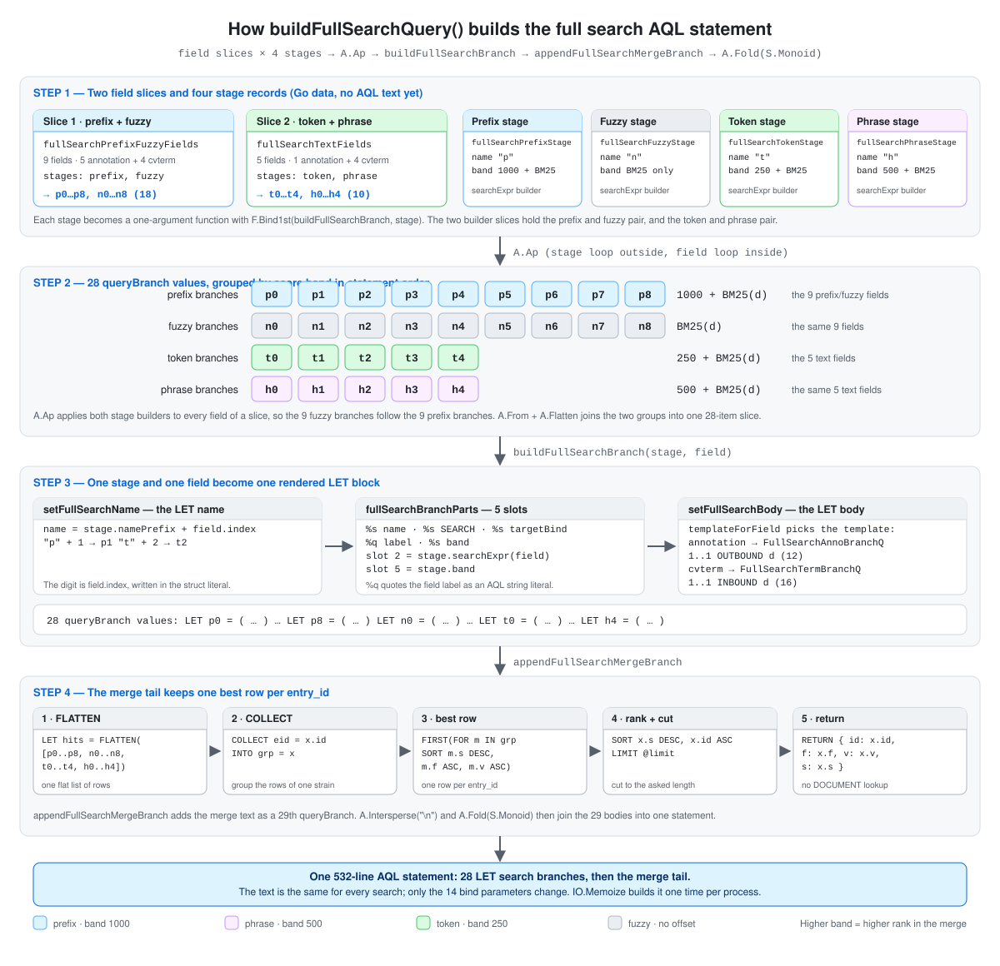

# How the Full Search AQL Statement Is Built

The `SearchAnnotation` method runs one large AQL statement. No file in
this repository holds that statement as finished text. The Go code
assembles it from small parts. This document follows those parts in
order. It shows which piece of Go code makes which piece of AQL.

## Table of Contents

- [What This Document Covers](#what-this-document-covers)
- [The Shape of the Final Statement](#the-shape-of-the-final-statement)
- [Visual Overview of the Build Pipeline](#visual-overview-of-the-build-pipeline)
- [Step 1: The Field Definitions](#step-1-the-field-definitions)
  - [The 9 Prefix and Fuzzy Fields](#the-9-prefix-and-fuzzy-fields)
  - [The 5 Text Fields](#the-5-text-fields)
  - [The Two Collections and the Three Field Selectors](#the-two-collections-and-the-three-field-selectors)
- [Step 2: The Four Stages and the 28 Branches](#step-2-the-four-stages-and-the-28-branches)
  - [The fullSearchStage Record](#the-fullsearchstage-record)
  - [A.Ap Makes the Cross Product](#aap-makes-the-cross-product)
  - [The Five SEARCH Expression Builders](#the-five-search-expression-builders)
  - [The Four Score Bands](#the-four-score-bands)
  - [The Full List of 28 Branches](#the-full-list-of-28-branches)
  - [The Tests That Hold the Count, the Bands, and the Order](#the-tests-that-hold-the-count-the-bands-and-the-order)
- [Step 3: From One Stage and One Field to One AQL LET Block](#step-3-from-one-stage-and-one-field-to-one-aql-let-block)
  - [The fullSearchBranchState Record](#the-fullsearchbranchstate-record)
  - [setFullSearchName Writes the Variable Name](#setfullsearchname-writes-the-variable-name)
  - [fullSearchBranchParts Fills the Five Slots](#fullsearchbranchparts-fills-the-five-slots)
  - [setFullSearchBody Selects the Template and Renders It](#setfullsearchbody-selects-the-template-and-renders-it)
  - [What Each Clause in the Annotation Template Does](#what-each-clause-in-the-annotation-template-does)
  - [What Each Clause in the cvterm Template Does](#what-each-clause-in-the-cvterm-template-does)
- [Step 4: The Merge Block and the Complete Statement](#step-4-the-merge-block-and-the-complete-statement)
  - [appendFullSearchMergeBranch Builds the Tail](#appendfullsearchmergebranch-builds-the-tail)
  - [What Each Clause in the Merge Block Does](#what-each-clause-in-the-merge-block-does)
  - [assembleFullSearchQuery Joins the Parts](#assemblefullsearchquery-joins-the-parts)
  - [IO.Memoize Builds the Statement One Time](#iomemoize-builds-the-statement-one-time)
  - [buildFullSearchQueryParams Attaches the Bind Parameters](#buildfullsearchqueryparams-attaches-the-bind-parameters)
- [The Assembled AQL](#the-assembled-aql)
  - [Branch p0, Prefix on the synonym Value](#branch-p0-prefix-on-the-synonym-value)
  - [Branch p1, Prefix on the genotype Value](#branch-p1-prefix-on-the-genotype-value)
  - [Branch n0, Fuzzy on the synonym Value](#branch-n0-fuzzy-on-the-synonym-value)
  - [Branch p5, Prefix on the phenotype Label](#branch-p5-prefix-on-the-phenotype-label)
  - [Branch t0, Token on the public_note Value](#branch-t0-token-on-the-public_note-value)
  - [Branch h0, Phrase on the public_note Value](#branch-h0-phrase-on-the-public_note-value)
  - [The Rendered Merge Block](#the-rendered-merge-block)
- [Source Files](#source-files)

## What This Document Covers

This document covers one subject only. That subject is the construction
of the full search AQL text. It explains the Go functions in plain
words, so a reader who does not know the `fp-go` library can follow the
code.

Topics outside this subject are not here. The document does not cover
these parts of the feature:

- The three custom analyzers and the built-in `text_en` analyzer
- The creation of the `annotation_full_search` view and its reconciliation
- The input validation, the limit clamp, and the stopword rule
- The target resolution query `fullSearchTargetsQ`
- The gRPC handler
- The read of the result rows from the database cursor

The glossary below explains in plain words each `fp-go` helper that the
code extracts use. Each helper is a small, ordinary operation with a
functional name.

| Helper | What it does |
|--------|--------------|
| `F.Pipe1` to `F.Pipe6` | Send one value through 1 to 6 functions in order. The result of one function becomes the input of the next. |
| `A.Map(f)` | Apply `f` to every item of a slice. The output slice has the same length. |
| `A.Ap(values)` | Take a slice of functions. Apply every function to every value. The outer loop is the function loop. |
| `A.From(a, b)` | Make a slice from the listed items. |
| `A.Flatten` | Join a slice of slices into one flat slice. |
| `A.Empty[A]()` | Make an empty slice of type `[]A`. |
| `A.Push(x)` | Add `x` to the end of a slice. The result is a new slice, and the input slice does not change. |
| `A.Append(as, x)` | Add `x` to the end of `as`. This form can write into the spare capacity of `as`. |
| `A.Intersperse(sep)` | Put `sep` between every two items of a slice. |
| `A.Fold(S.Monoid)` | Concatenate a slice of strings into one string. With `A.Intersperse` the pair gives the result of `strings.Join`. |
| `P.Fold(onFalse, onTrue)` | Take a yes/no test and two functions. Run `onTrue` when the test says yes, and `onFalse` when it says no. |
| `P.ContraMap(get)` | Move a test onto a larger type. The test runs on the value that `get` reads out of that type. |
| `EQ.Equals(eq)(x)` | Make a test that compares its input with `x`. |
| A lens | A read and write pair for one struct field. `Get` reads the field. `Set(v)` returns a **copy** of the struct with the new value. The code never mutates a struct in place. |
| `L.Compose` | Join two lenses into one lens that reads and writes a nested field. |
| `F.Bind1st(f, x)` | Fix the first argument of a two-argument function. The result takes the second argument only. |
| `F.Flip(f)` | Exchange the two arguments of a curried function. |
| `S.Format(tpl)` | Put one value into a format template. This is `fmt.Sprintf` with the template fixed first. |
| `IO.Memoize(f)` | Wrap a no-argument function. The first call runs `f`. Every later call returns the stored result. |

## The Shape of the Final Statement

The generated statement is 532 lines long and has two regions.

1. **28 `LET` search branches.** Each branch is an independent
   sub-query over the `annotation_full_search` view. Each branch
   searches one field in one way, keeps at most `@limit` rows, and
   returns a flat row object. The branch variables come in four groups:
   `p0` to `p8`, then `n0` to `n8`, then `t0` to `t4`, then `h0` to
   `h4`.
2. **One merge and rank region.** It collects the rows of all 28
   branches and keeps the best row for each strain `entry_id`. It then
   sorts the survivors and cuts the list to `@limit`.

```
LET p0 = ( ... )     <- branch  1: prefix on the synonym value
LET p1 = ( ... )     <- branch  2: prefix on the genotype value
...
LET p8 = ( ... )     <- branch  9: prefix on the characteristic label
LET n0 = ( ... )     <- branch 10: fuzzy  on the synonym value
...
LET n8 = ( ... )     <- branch 18: fuzzy  on the characteristic label
LET t0 = ( ... )     <- branch 19: token  on the public_note value
...
LET t4 = ( ... )     <- branch 23: token  on the characteristic label
LET h0 = ( ... )     <- branch 24: phrase on the public_note value
...
LET h4 = ( ... )     <- branch 28: phrase on the characteristic label
LET hits = FLATTEN([p0, ..., h4])
LET best = ( ... )   <- one best row per entry_id
FOR x IN best        <- final sort and final LIMIT
```

The 28 branches stand in band groups. All prefix branches come first,
then all fuzzy branches, then the token branches, then the phrase
branches. The branches never share state. The build code can therefore
treat each branch as one independent value. A reader can also read one
branch without the other 27.

The merge region of this statement reads no document. The branch rows
already carry the 4 attributes that the API returns. A reader who knows
the full search of a sister service must not expect a `DOCUMENT` lookup
here.

## Visual Overview of the Build Pipeline

The diagram below shows the four steps on one page. Read it from the
top to the bottom. Each large row is one step of this document, and the
label on each arrow is the call that performs that step. The colour of
a box is the score band of its branches: blue for prefix, purple for
phrase, green for token, and grey for fuzzy.



- **Step 1** holds two field slices and four stage records. A field
  names its indexed attribute, its collection, and the bind parameter
  of its required cvterm target. A stage holds the name prefix, the
  `SEARCH` expression builder, and the score band.
- **Step 2** applies both stage builders of a slice to every field of
  that slice. The cross product gives 18 identifier branches and 10
  text branches. The chips in the diagram stand in statement order:
  `p0` to `p8`, then `n0` to `n8`, then `t0` to `t4`, then `h0` to
  `h4`.
- **Step 3** runs inside each builder call. It writes the `LET`
  variable name, fills the five template slots, and selects one of the
  two branch templates. The collection of the field picks the
  traversal direction: `OUTBOUND` for the 12 annotation branches, and
  `INBOUND` for the 16 cvterm branches.
- **Step 4** adds the merge tail as a 29th branch. The tail flattens
  the 28 row lists, groups them by `entry_id`, keeps one best row per
  strain, ranks the survivors, and cuts the list to `@limit`.

## Step 1: The Field Definitions

The build starts from data, not from text. Two slices in
`internal/repository/arangodb/fullsearch_query.go` name the searched
fields. Each entry is a `fullSearchField` with five parts.

| Part | What it holds |
|------|---------------|
| `index` | The 0-based position inside its own group. The digit of the `LET` variable comes from this value. |
| `label` | The canonical field label that the row reports as `f`, such as `genetic_modification`. |
| `coll` | `fullSearchCollAnno` or `fullSearchCollTerm`. This part selects the indexed attribute and the branch template. |
| `targetBind` | The name of the bind parameter that holds the required cvterm `_id` or ontology `graph_id`. |
| `isGenotype` | `true` for the genotype field only. This part selects the prefix expression. |

The `index` is written in the struct literal and is not derived from
the slice position. A new field in the middle of a slice therefore
needs a manual renumber of the entries below it.

### The 9 Prefix and Fuzzy Fields

`fullSearchPrefixFuzzyFields` holds the short, name-like fields. Each
field gets a prefix branch `p<index>` and a fuzzy branch `n<index>`.

| Index | Label | Collection | Target bind parameter | Genotype |
|-------|-------|------------|-----------------------|----------|
| 0 | `synonym` | annotation | `@synonym_term_id` | no |
| 1 | `genotype` | annotation | `@genotype_term_id` | **yes** |
| 2 | `systematic_name` | annotation | `@sysname_term_id` | no |
| 3 | `genetic_modification` | annotation | `@muttype_term_id` | no |
| 4 | `mutagenesis_method` | annotation | `@mutmethod_term_id` | no |
| 5 | `phenotype` | cvterm | `@phenotype_graph_id` | no |
| 6 | `environment` | cvterm | `@env_graph_id` | no |
| 7 | `assay` | cvterm | `@assay_graph_id` | no |
| 8 | `characteristic` | cvterm | `@char_graph_id` | no |

The first 5 fields live on the annotation collection. The last 4 live
on the cvterm collection. These 9 fields therefore produce 18 of the 28
branches.

The `label` is the API field name and not the ontology tag label. The
difference is visible in `fullSearchBindParams`. The field
`genetic_modification` binds the cvterm of the tag `mutant type`, and
the field `mutagenesis_method` binds the cvterm of the tag
`mutagenesis method`. The two names `synonym` and `genotype` are equal
in both roles, and the autocomplete feature shares those two constants.

### The 5 Text Fields

`fullSearchTextFields` holds the fields that the English text analyzer
indexes. Each field gets a token branch `t<index>` and a phrase branch
`h<index>`.

| Index | Label | Collection | Target bind parameter |
|-------|-------|------------|-----------------------|
| 0 | `public_note` | annotation | `@pubnote_term_id` |
| 1 | `phenotype` | cvterm | `@phenotype_graph_id` |
| 2 | `environment` | cvterm | `@env_graph_id` |
| 3 | `assay` | cvterm | `@assay_graph_id` |
| 4 | `characteristic` | cvterm | `@char_graph_id` |

The 4 cvterm fields appear in both slices. An ontology label therefore
gets 4 branches: prefix, fuzzy, token, and phrase. The annotation
values of the first slice get no token or phrase branch, because a
synonym or a genotype is an identifier and not prose. The long prose of
the annotation collection reaches the index through `public_note` only.

### The Two Collections and the Three Field Selectors

Three package variables resolve every field-dependent value. All three
read the field and return one value. The two templates and the two
indexed attributes come from the collection, and the prefix expression
comes from the genotype flag.

```go
isTermCollField = F.Pipe2(
	fullSearchCollTerm,
	EQ.Equals(fullSearchCollEq),
	P.ContraMap(fieldCollLens.Get),
)

docAttrForField = F.Pipe1(
	isTermCollField,
	P.Fold(annoDocAttr, termDocAttr),
)

templateForField = F.Pipe1(
	isTermCollField,
	P.Fold(annoBranchTemplate, termBranchTemplate),
)

prefixExprForField = F.Pipe1(
	fieldIsGenotypeLens.Get,
	P.Fold(standardFullSearchPrefixExpr, genotypeFullSearchPrefixExpr),
)
```

`EQ.Equals(fullSearchCollEq)(fullSearchCollTerm)` is a test on a
`fullSearchColl` value. `P.ContraMap(fieldCollLens.Get)` moves that
test onto a whole `fullSearchField`. The result `isTermCollField`
answers one question: does this field live on the cvterm collection?

`P.Fold` is a two-way switch. The `onFalse` function comes first in the
argument list, which is the usual `fp-go` order. The table below gives
the two outcomes of each selector.

| Selector | Test | Result when the test says no | Result when the test says yes |
|----------|------|------------------------------|-------------------------------|
| `docAttrForField` | `isTermCollField` | `value` | `label` |
| `templateForField` | `isTermCollField` | `FullSearchAnnoBranchQ` | `FullSearchTermBranchQ` |
| `prefixExprForField` | `fieldIsGenotypeLens.Get` | `standardFullSearchPrefixExpr` | `genotypeFullSearchPrefixExpr` |

The four functions behind these folds take a `fullSearchField` and
ignore it or read one part of it. `annoDocAttr` and `termDocAttr`
return `docFieldValue` and `docFieldLabel`. `annoBranchTemplate` and
`termBranchTemplate` return the two template constants. The uniform
signature is the reason that `P.Fold` can hold any pair of them.

## Step 2: The Four Stages and the 28 Branches

### The fullSearchStage Record

A `fullSearchStage` is the complete plan of one search kind. It carries
three values and no field data.

```go
fullSearchStage struct {
	namePrefix string                    // "p", "n", "t", or "h"
	searchExpr func(fullSearchField) string // the SEARCH expression builder
	band       string                    // the score expression
}
```

The package declares exactly four of them.

| Stage variable | Name prefix | Expression builder | Band constant |
|----------------|-------------|--------------------|---------------|
| `fullSearchPrefixStage` | `p` | `prefixExprForField` | `fullSearchPrefixBand` |
| `fullSearchFuzzyStage` | `n` | `fuzzyExprForField` | `fullSearchFuzzyBand` |
| `fullSearchTokenStage` | `t` | `tokenExprForField` | `fullSearchTokenBand` |
| `fullSearchPhraseStage` | `h` | `phraseExprForField` | `fullSearchPhraseBand` |

The stage holds the only values that differ between two branches of the
same field. A new search kind needs one new stage value and one new
expression builder. It needs no change in the templates and no change
in the field slices.

### A.Ap Makes the Cross Product

The two builder slices turn a stage into a one-argument function.

```go
prefixFuzzyBranchBuilders = []func(fullSearchField) queryBranch{
	F.Bind1st(buildFullSearchBranch, fullSearchPrefixStage),
	F.Bind1st(buildFullSearchBranch, fullSearchFuzzyStage),
}
```

`buildFullSearchBranch` takes a stage and a field. `F.Bind1st` fixes
the stage, so the result takes a field only. The two builder slices
hold the prefix and fuzzy pair, and the token and phrase pair.

```go
func prefixFuzzyBranches() []queryBranch {
	return F.Pipe1(
		prefixFuzzyBranchBuilders,
		A.Ap[queryBranch](fullSearchPrefixFuzzyFields),
	)
}
```

`A.Ap` applies every function to every value. Its outer loop is the
function loop, and its inner loop is the value loop. The order of the
output is therefore stage first and field second.

| Call | Functions | Values | Output order |
|------|-----------|--------|--------------|
| `prefixFuzzyBranches()` | prefix, fuzzy | 9 fields | `p0` to `p8`, then `n0` to `n8` |
| `tokenPhraseBranches()` | token, phrase | 5 fields | `t0` to `t4`, then `h0` to `h4` |

This loop order is the reason that the statement groups the branches by
band. The fuzzy branch of a field stands 9 positions after its prefix
branch. The phrase branch of a text field stands 5 positions after its
token branch.

The order of the `LET` blocks does not change the result rows. The
merge in [Step 4](#what-each-clause-in-the-merge-block-does) groups the
rows by `entry_id`. It then breaks a tie on the score, then on the
field label, then on the display value. That tie-break decides between
any two rows, so no branch wins a tie through its position in the text.

### The Five SEARCH Expression Builders

Four stages use five builders, because the prefix stage selects between
two of them. Each builder returns the text that follows the AQL keyword
`SEARCH`. The placeholder `<attr>` is `value` on the annotation
collection and `label` on the cvterm collection.

| Go function | Stage | Applies to | Generated AQL | Analyzer |
|-------------|-------|-----------|---------------|----------|
| `standardFullSearchPrefixExpr` | prefix | 8 non-genotype fields | `ANALYZER(STARTS_WITH(d.<attr>, @q), "annotation_search_norm")` | norm |
| `genotypeFullSearchPrefixExpr` | prefix | the genotype field only | `(ANALYZER(STARTS_WITH(d.value, @q), "annotation_search_norm") OR ANALYZER(STARTS_WITH(d.value, @q), "annotation_search_delim"))` | norm and delim |
| `fuzzyExprForField` | fuzzy | all 9 fields | `NGRAM_MATCH(d.<attr>, @q, @th, "annotation_search_ngram")` | ngram |
| `tokenExprForField` | token | all 5 text fields | `ANALYZER(d.<attr> IN TOKENS(@q, "text_en"), "text_en")` | `text_en` |
| `phraseExprForField` | phrase | all 5 text fields | `PHRASE(d.<attr>, @q, "text_en")` | `text_en` |

Three builders need the `ANALYZER(...)` wrapper and two do not.

- `STARTS_WITH` has no analyzer argument. Without the wrapper the
  comparison runs under the `identity` analyzer and matches nothing.
- The `IN TOKENS` form passes `"text_en"` to `TOKENS`, but that call
  analyzes the query text only. The wrapper makes the comparison
  against the indexed value run under the same analyzer that built the
  index. The analyzer name therefore appears twice in that expression.
- `NGRAM_MATCH` takes the analyzer as its fourth argument, and `PHRASE`
  takes it as its last argument. The wrapper is unnecessary for both.

The genotype builder is the one special case of the statement. A
genotype value is a comma-separated list, such as
`axeA1, axeB1, sadA-[sadA-KO]`. The norm analyzer indexes the whole
string, so a prefix search finds the first allele only. The delimiter
analyzer splits the value on commas and spaces, so the `OR` arm finds
an interior allele. `TestBuildFullSearchQueryBranchCount` asserts that
`annotation_search_delim` occurs exactly one time in the statement,
which pins this expression to branch `p1`.

The genotype builder ignores its field argument and writes
`docFieldValue` as a literal. That choice is correct today, because the
genotype field is the only field with `isGenotype: true` and it lives
on the annotation collection. A future cvterm field with that flag gets
the wrong attribute. The flag and the collection are two independent
parts of the struct, and nothing in the code ties them.

Only the fuzzy branches use `@th`. That bind parameter carries the
n-gram similarity threshold.

### The Four Score Bands

The `band` value becomes the `s` attribute of each returned row. The
four bands are constants in `fullsearch.go`.

| Constant | Value | Used by | Count |
|----------|-------|---------|-------|
| `fullSearchPrefixBand` | `1000 + BM25(d)` | `p0` to `p8` | 9 |
| `fullSearchPhraseBand` | `500 + BM25(d)` | `h0` to `h4` | 5 |
| `fullSearchTokenBand` | `250 + BM25(d)` | `t0` to `t4` | 5 |
| `fullSearchFuzzyBand` | `BM25(d)` | `n0` to `n8` | 9 |

The offsets are 250 apart and they fix the rank order. A prefix hit
stands above a phrase hit, a phrase hit above a token hit, and a token
hit above a fuzzy hit. The offset, and not `BM25`, carries the stage
order, because a `STARTS_WITH` match can score a `BM25` of 0. The
offsets must also stay above every possible `BM25` value in the
corpus. This repository records no measured `BM25` maximum, so the
margin of 250 is a design choice and not a measured limit.

`TestSearchAnnotationBandOrdering` proves the order against a live
database. It stores one synonym prefix hit, one phrase hit, one token
hit, and one misspelled synonym. It then asserts the 4 rows in that
order, with the score thresholds 1000, 500, and 250.

### The Full List of 28 Branches

The rows are in statement order.

| # | Variable | Field | Collection | SEARCH kind | Band |
|---|----------|-------|------------|-------------|------|
| 1 | `p0` | `synonym` | annotation | prefix | `1000 + BM25(d)` |
| 2 | `p1` | `genotype` | annotation | prefix, norm and delim | `1000 + BM25(d)` |
| 3 | `p2` | `systematic_name` | annotation | prefix | `1000 + BM25(d)` |
| 4 | `p3` | `genetic_modification` | annotation | prefix | `1000 + BM25(d)` |
| 5 | `p4` | `mutagenesis_method` | annotation | prefix | `1000 + BM25(d)` |
| 6 | `p5` | `phenotype` | cvterm | prefix | `1000 + BM25(d)` |
| 7 | `p6` | `environment` | cvterm | prefix | `1000 + BM25(d)` |
| 8 | `p7` | `assay` | cvterm | prefix | `1000 + BM25(d)` |
| 9 | `p8` | `characteristic` | cvterm | prefix | `1000 + BM25(d)` |
| 10 | `n0` | `synonym` | annotation | fuzzy | `BM25(d)` |
| 11 | `n1` | `genotype` | annotation | fuzzy | `BM25(d)` |
| 12 | `n2` | `systematic_name` | annotation | fuzzy | `BM25(d)` |
| 13 | `n3` | `genetic_modification` | annotation | fuzzy | `BM25(d)` |
| 14 | `n4` | `mutagenesis_method` | annotation | fuzzy | `BM25(d)` |
| 15 | `n5` | `phenotype` | cvterm | fuzzy | `BM25(d)` |
| 16 | `n6` | `environment` | cvterm | fuzzy | `BM25(d)` |
| 17 | `n7` | `assay` | cvterm | fuzzy | `BM25(d)` |
| 18 | `n8` | `characteristic` | cvterm | fuzzy | `BM25(d)` |
| 19 | `t0` | `public_note` | annotation | token | `250 + BM25(d)` |
| 20 | `t1` | `phenotype` | cvterm | token | `250 + BM25(d)` |
| 21 | `t2` | `environment` | cvterm | token | `250 + BM25(d)` |
| 22 | `t3` | `assay` | cvterm | token | `250 + BM25(d)` |
| 23 | `t4` | `characteristic` | cvterm | token | `250 + BM25(d)` |
| 24 | `h0` | `public_note` | annotation | phrase | `500 + BM25(d)` |
| 25 | `h1` | `phenotype` | cvterm | phrase | `500 + BM25(d)` |
| 26 | `h2` | `environment` | cvterm | phrase | `500 + BM25(d)` |
| 27 | `h3` | `assay` | cvterm | phrase | `500 + BM25(d)` |
| 28 | `h4` | `characteristic` | cvterm | phrase | `500 + BM25(d)` |

12 branches use the annotation template: `p0` to `p4`, `n0` to `n4`,
`t0`, and `h0`. The other 16 use the cvterm template. The counts of 12
and 16 appear again in the branch count test.

### The Tests That Hold the Count, the Bands, and the Order

Four tests in `fullsearch_test.go` protect this step. The first three
need no database, because the build functions read no request data. The
fourth needs a live database.

| Test | What it pins |
|------|--------------|
| `TestBuildFullSearchQueryBranchCount` | The presence of `LET p0` to `LET p8`, `LET n0` to `LET n8`, `LET t0` to `LET t4`, and `LET h0` to `LET h4`. It also counts 28 view scans, 12 `OUTBOUND` traversals, 16 `INBOUND` traversals, 1 delimiter analyzer, 9 `NGRAM_MATCH` calls, 5 `IN TOKENS` calls, and 5 `PHRASE` calls. It asserts that `@@cv_collection` is absent. |
| `TestBuildFullSearchQueryBandCounts` | The band of every branch. It counts the `s: ` slot and asserts 9 prefix, 5 phrase, 5 token, and 9 fuzzy bands. |
| `TestBuildFullSearchQueryFilterOrder` | The order of the 28 `LET` markers, and the clause order inside each branch. In every branch `SORT BM25(d)` comes before `LIMIT @limit`. In the 12 annotation branches `FILTER has_tag == true` comes before the sort. In the 16 cvterm branches `FILTER ann.is_obsolete == false` comes before the sort. |
| `TestBuildFullSearchQueryIsValidAQL` | The syntax of the whole statement. It calls `ValidateQuery` on the database handle, so ArangoDB parses the 532 lines. |

The band test counts the `s: ` slot and not the bare band text. The
fuzzy band is `BM25(d)` with no offset, so a plain count of that text
also matches the 3 other bands and every `SORT BM25(d)` clause.

The absence of `@@cv_collection` matters. The target resolution runs in
its own query before the search. The 28-branch statement reads the two
linked collections through the view and the graph only, so it never
scans the cv collection.

## Step 3: From One Stage and One Field to One AQL LET Block

`buildFullSearchBranch` turns one stage and one field into one rendered
branch. It is a 5-stage pipe over an empty state record.

```go
func buildFullSearchBranch(
	stage fullSearchStage,
	f fullSearchField,
) queryBranch {
	return F.Pipe5(
		fullSearchBranchState{},
		fullSearchStageLens.Set(stage),
		fullSearchFieldLens.Set(f),
		setFullSearchName,
		setFullSearchBody,
		fullSearchBranchLens.Get,
	)
}
```

The first two steps load the inputs. The next two steps fill the two
parts of the branch. The last step reads the finished branch out of the
state and discards the rest.

### The fullSearchBranchState Record

The state carries the two inputs and the output under construction.

```go
fullSearchBranchState struct {
	stage  fullSearchStage
	field  fullSearchField
	branch queryBranch
}
```

Five composed lenses reach the nested parts in one call. They save the
code a read of the outer struct before a read of the inner field.

| Composed lens | Reads and writes |
|---------------|------------------|
| `fullSearchStateIndexLens` | `state.field.index` |
| `fullSearchStateLabelLens` | `state.field.label` |
| `fullSearchStateTargetBindLens` | `state.field.targetBind` |
| `fullSearchStateNameLens` | `state.branch.name` |
| `fullSearchStateBodyLens` | `state.branch.body` |

The last two reach into `queryBranch` through `nameLens` and `bodyLens`.
Those two lenses live in `autocomplete_query.go`, and the autocomplete
feature and the full search feature share them. The `queryBranch` type
is shared in the same way.

### setFullSearchName Writes the Variable Name

The variable name is the stage prefix and the field index.

```go
func setFullSearchName(s fullSearchBranchState) fullSearchBranchState {
	stage := fullSearchStageLens.Get(s)
	name := fmt.Sprintf("%s%d", stage.namePrefix, fullSearchStateIndexLens.Get(s))

	return F.Pipe1(s, fullSearchStateNameLens.Set(name))
}
```

The prefix comes from the stage and the digit comes from the field.
Branch `t2` is therefore the token stage on field index 2, which is
`environment`. `fullSearchStateNameLens.Set(name)` returns a function.
That function takes a state and returns a **new** state with the name
in place. The input state does not change.

### fullSearchBranchParts Fills the Five Slots

Both templates carry exactly five `fmt.Sprintf` verbs in the same
order. `fullSearchBranchParts` builds the 5-item argument slice.

```go
func fullSearchBranchParts(st fullSearchBranchState) []any {
	stage := fullSearchStageLens.Get(st)
	field := fullSearchFieldLens.Get(st)

	return F.Pipe5(
		A.Empty[any](),
		A.Push[any](fullSearchStateNameLens.Get(st)),
		A.Push[any](stage.searchExpr(field)),
		A.Push[any](fullSearchStateTargetBindLens.Get(st)),
		A.Push[any](fullSearchStateLabelLens.Get(st)),
		A.Push[any](stage.band),
	)
}
```

Each `A.Push` adds one argument and returns a new slice. The pipe reads
in the same order as the verbs of the template.

| Slot | Verb | Value | Position in the AQL |
|------|------|-------|---------------------|
| 1 | `%s` | the branch name | the `LET <name> = (` variable |
| 2 | `%s` | `stage.searchExpr(field)` | the last `AND` term of the `SEARCH` clause |
| 3 | `%s` | `field.targetBind` | the bind parameter name after `@` in the target filter |
| 4 | `%q` | `field.label` | the `f:` attribute, as a quoted string |
| 5 | `%s` | `stage.band` | the `s:` attribute |

Slot 2 is the only slot that reads the stage expression builder. Slot 5
is the only slot that reads the band. Slots 1, 3, and 4 read the field
and the name.

Slot 3 is a bare name and not a bind reference. The template holds the
`@` sign, so the rendered text is `@synonym_term_id` from the value
`synonym_term_id`. Slot 4 uses `%q` and not `%s`, because the field
label must appear in the AQL as a string literal.

### setFullSearchBody Selects the Template and Renders It

```go
func setFullSearchBody(s fullSearchBranchState) fullSearchBranchState {
	tpl := F.Pipe2(s, fullSearchFieldLens.Get, templateForField)

	return F.Pipe3(
		s,
		fullSearchBranchParts,
		F.Bind1st(formatWithTemplate, tpl),
		setFullSearchBranchBody(s),
	)
}
```

The first line reads the field and selects the template with
`templateForField` of [Step 1](#the-two-collections-and-the-three-field-selectors).
`F.Bind1st(formatWithTemplate, tpl)` fixes that template, so the
remaining function takes the parts slice only.

`setFullSearchBranchBody(s)` is the write step. It calls
`F.Flip(fullSearchStateBodyLens.Set)` on the state, which exchanges the
two arguments of the curried setter. The flipped form takes the
rendered string last, so it fits at the end of a pipe. A plain
`Set(body)(s)` call needs the body before the state, and the pipe
produces the body as its final value.

The two templates differ in the direction of the graph traversal and in
the source of the row attributes.

| Template | Branches | Matched document | Traversal | Reason |
|----------|----------|------------------|-----------|--------|
| `FullSearchAnnoBranchQ` | `p0` to `p4`, `n0` to `n4`, `t0`, `h0` | the annotation document | `1..1 OUTBOUND d` | The match carries `entry_id` and `value`. The traversal only has to prove that the annotation hangs on the required cvterm tag. |
| `FullSearchTermBranchQ` | `p5` to `p8`, `n5` to `n8`, `t1` to `t4`, `h1` to `h4` | the cvterm document | `1..1 INBOUND d` | The match carries the label but no strain. The traversal walks backward to every annotation that uses the term, and those annotations supply `entry_id`. |

### What Each Clause in the Annotation Template Does

1. **`FOR d IN annotation_full_search`.** This opens the view scan. The
   view name is literal text in the template and not a bind parameter.
   ArangoDB does not accept a bind parameter for a view name in
   `SEARCH`. The constant `fullSearchViewName` holds the same text, and
   `TestBuildFullSearchQueryBranchCount` compares the two.
2. **`SEARCH d.is_obsolete == false AND ANALYZER(STARTS_WITH(d.entry_id, "dbs"), "annotation_search_norm") AND <expression>`.**
   The first term drops a superseded annotation version. The second
   term keeps strain annotations only, because every strain `entry_id`
   starts with `DBS`. The norm analyzer lowercases the indexed
   `entry_id`, so the literal `"dbs"` matches `DBS0236125`. The third
   term is slot 2.
3. **`LET has_tag = FIRST(FOR cvt, e IN 1..1 OUTBOUND d GRAPH @anno_cvterm_graph FILTER e._to == @<bind> AND cvt.deprecated == false RETURN true)`.**
   One hop over the annotation and cvterm graph proves the tag of the
   match. The edge filter is an equality on `e._to`, so the branch
   accepts the one tag of slot 3 and no other tag. `FIRST` stops after
   one hit. The term filter drops a tag that an ontology load
   deprecated.
4. **`FILTER has_tag == true`.** This drops every row whose tag does
   not match. A missing target binds as an empty string, so
   `e._to == ""` is never true and the whole branch returns no row.
   An unloaded ontology therefore degrades the search and does not
   break it.
5. **`SORT BM25(d) DESC, d.entry_id ASC, d._key ASC` and `LIMIT @limit`.**
   The branch keeps its own best rows and discards the rest. The two
   key tiebreaks make the cut deterministic between rows of equal
   relevance. Because every branch caps itself, at most 28 × `@limit`
   rows reach the merge, which is 1400 rows at the default limit of 50.
6. **`RETURN { id, f, v, s }`.** The branch returns a flat object and
   not a document. All 28 branches return the same 4 attributes, which
   is the reason that the merge can treat the rows as one list.

| Attribute | Content in an annotation branch |
|-----------|---------------------------------|
| `id` | `d.entry_id`, the public strain ID, such as `DBS0236125`. The merge groups on this value. |
| `f` | The canonical field label. Slot 4 writes it. |
| `v` | `NOT_NULL(d.value, "")`, the annotation value. |
| `s` | The score. Slot 5 writes it. |

### What Each Clause in the cvterm Template Does

1. **`FOR d IN annotation_full_search` and `SEARCH d.deprecated == false AND <expression> AND d.graph_id == @<bind>`.**
   The same view holds both collections, so the scan is identical. The
   first term drops a deprecated term. The third term restricts the
   match to one ontology, because `graph_id` is the `_id` of the cv
   document. Slot 3 supplies that bind name, and the branch therefore
   searches one ontology only.
2. **`FOR ann IN 1..1 INBOUND d GRAPH @anno_cvterm_graph`.** This walks
   backward from the term to every annotation that uses it. The
   traversal is not inside a `FIRST`, so one term with many annotations
   produces many rows. That fan-out is intended, because each
   annotation is a separate strain result.
3. **`FILTER ann.is_obsolete == false AND STARTS_WITH(LOWER(ann.entry_id), "dbs")`.**
   These are the same two gates as the annotation template, but they
   run on the traversed document. `ann` does not come from the view, so
   no analyzer applies to it. The filter therefore calls `LOWER`
   explicitly instead of the norm analyzer.
4. **`SORT BM25(d) DESC, ann.entry_id ASC, ann._key ASC` and `LIMIT @limit`.**
   The sort and the limit apply to the combined stream of the two
   loops, so the branch emits at most `@limit` rows in total. Every
   annotation of one term shares the same `BM25(d)`, because `d` is the
   term and not the annotation. The `entry_id` tiebreak therefore
   decides the whole order inside one term.
   `TestSearchAnnotationHighFanOutTermRespectsLimitAndOrder` stores 55
   annotations on one phenotype term. It then asserts the first 50
   `entry_id` values in order from the lowest value.
5. **`RETURN { id, f, v, s }`.** The shape is the same as the
   annotation branch, but `id` comes from `ann.entry_id` and `v` comes
   from `NOT_NULL(d.label, "")`. The display text of a cvterm branch is
   therefore the ontology label, not the annotation value. The
   annotation value of such a row is a placeholder, so the label is the
   only useful text.

## Step 4: The Merge Block and the Complete Statement

### appendFullSearchMergeBranch Builds the Tail

The merge block needs one value only. That value is the list of the 28
branch variable names.

```go
func appendFullSearchMergeBranch(branches []queryBranch) []queryBranch {
	setBody := F.Pipe1(queryBranch{}, F.Flip(bodyLens.Set))

	return F.Pipe6(
		branches,
		A.Map(nameLens.Get),
		A.Intersperse(", "),
		A.Fold(S.Monoid),
		S.Format[string](FullSearchMergeQ),
		setBody,
		F.Bind1st(A.Append, branches),
	)
}
```

The six steps are easy to read in sequence. `A.Map(nameLens.Get)` takes
the `name` of each branch, which gives `["p0", "p1", ..., "h4"]`.
`A.Intersperse(", ")` puts the separator between the names, and
`A.Fold(S.Monoid)` concatenates the 55 pieces into the single string
`p0, p1, ..., h4`. `S.Format(...)` puts that string into the one `%s`
of `FullSearchMergeQ`. `setBody` wraps the rendered text in an empty
`queryBranch`, and `F.Bind1st(A.Append, branches)` adds that branch to
the end of the list.

The merge branch has an empty `name`. Nothing reads the name after this
point, because the next step reads bodies only. The merge therefore
travels as a 29th `queryBranch` and needs no separate type.

`A.Append` can write into the spare capacity of `branches`, unlike
`A.Push`. That behavior is safe here, because the caller never reads
`branches` again after this call.

### What Each Clause in the Merge Block Does

1. **`LET hits = FLATTEN([p0, p1, ..., h4])`.** Each branch variable
   holds an array of rows, so the bracket list is an array of arrays.
   `FLATTEN` makes it one array of rows. The variable is named `hits`
   and not `all`, because `all` is a reserved word in AQL.
2. **`COLLECT eid = x.id INTO grp = x`.** This groups the rows by
   strain `entry_id`. One strain can match in many branches and in both
   collections. The group holds every row of that strain.
3. **`LET top = FIRST(FOR m IN grp SORT m.s DESC, m.f ASC, m.v ASC RETURN m)`.**
   Inside each group the rows sort by score, then by field label, then
   by display value. `FIRST` keeps one row. The result is one row per
   strain, and that row has the highest score of the group. The two
   extra tiebreaks make the choice stable when two fields of one strain
   score the same.
   `TestSearchAnnotationCrossCollectionDeduplicationKeepsBestField`
   stores one synonym and one phenotype term on the same `entry_id`
   and asserts that the search returns one row with the synonym field.
4. **`FOR x IN best`, `SORT x.s DESC, x.id ASC`, `LIMIT @limit`.** The
   deduplicated rows sort once more. `LIMIT @limit` then cuts the list
   to the requested length.
5. **`RETURN { id, f, v, s }`.** This is the final row shape. The Go
   type `fullSearchRow` decodes it with the same JSON tags, and
   `toFullSearchResult` maps the 4 attributes to `EntryID`, `Field`,
   `DisplayText`, and `Score`.

### assembleFullSearchQuery Joins the Parts

The top-level function builds the two branch groups and then runs one
pipe.

```go
func assembleFullSearchQuery() string {
	prefixFuzzy := prefixFuzzyBranches()
	tokenPhrase := tokenPhraseBranches()

	return F.Pipe5(
		A.From(prefixFuzzy, tokenPhrase),
		A.Flatten[queryBranch],
		appendFullSearchMergeBranch,
		A.Map(bodyLens.Get),
		A.Intersperse("\n"),
		A.Fold(S.Monoid),
	)
}
```

| Line | Input | Output |
|------|-------|--------|
| `A.From(prefixFuzzy, tokenPhrase)` | 2 slices | one slice of 2 slices |
| `A.Flatten[queryBranch]` | 2 slices | 28 `queryBranch` values |
| `appendFullSearchMergeBranch` | 28 branches | 29 branches, with the merge block last |
| `A.Map(bodyLens.Get)` | 29 branches | 29 body strings |
| `A.Intersperse("\n")` | 29 strings | 57 strings, with a newline between each pair |
| `A.Fold(S.Monoid)` | 57 strings | the complete statement of 532 lines |

The two group calls bind to variables before the pipe starts. The house
style of this repository forbids a call expression as an argument to
another call.

The 532 lines break down as follows. An annotation branch renders 20
lines, and 12 of them give 240 lines. A cvterm branch renders 17 lines,
and 16 of them give 272 lines. The merge block adds 20 lines.

### IO.Memoize Builds the Statement One Time

```go
buildFullSearchQuery = IO.Memoize(assembleFullSearchQuery)
```

`assembleFullSearchQuery` takes no arguments and depends on no request
data. The statement is identical for every search, and only the bind
parameters change. `IO.Memoize` therefore stores the result after the
first call. The wrapper uses `sync.Once`, so a concurrent request is
safe and the build work happens one time in the lifetime of the
process.

The call site does not change because of the wrapper.
`buildFullSearchQuery()` is still a plain no-argument call, in the
production path and in the three builder tests.

### buildFullSearchQueryParams Attaches the Bind Parameters

The statement and its values travel together in one struct.

```go
func (ar *arangorepository) buildFullSearchQueryParams(
	req fullSearchRequest,
) fullSearchQueryParams {
	statement := buildFullSearchQuery()
	bindParams := ar.fullSearchBindParams(req)

	return F.Pipe2(
		fullSearchQueryParams{},
		fullSearchStmtLens.Set(statement),
		fullSearchBindLens.Set(bindParams),
	)
}
```

`fullSearchBindParams` builds a map of 14 entries.

| Bind parameter | Source | Used by |
|----------------|--------|---------|
| `@q` | the normalized query text | every `SEARCH` expression |
| `@th` | `fullSearchNgramThreshold`, the constant `0.3` | the 9 fuzzy branches only |
| `@limit` | the clamped request limit, 1 to 50 | the `LIMIT` of all 28 branches and the final `LIMIT` |
| `@anno_cvterm_graph` | `ar.anno.annotg.Name()`, the live graph name | the traversal of all 28 branches |
| `@synonym_term_id` | `tags["dicty_annotation:synonym"]` | `p0`, `n0` |
| `@genotype_term_id` | `tags["dicty_annotation:genotype"]` | `p1`, `n1` |
| `@sysname_term_id` | `tags["dicty_annotation:systematic name"]` | `p2`, `n2` |
| `@muttype_term_id` | `tags["dicty_annotation:mutant type"]` | `p3`, `n3` |
| `@mutmethod_term_id` | `tags["Dd Mutagenesis Method:mutagenesis method"]` | `p4`, `n4` |
| `@pubnote_term_id` | `tags["dicty_annotation:public note"]` | `t0`, `h0` |
| `@phenotype_graph_id` | `graphs["Dicty Phenotypes"]` | `p5`, `n5`, `t1`, `h1` |
| `@env_graph_id` | `graphs["Dicty Environment"]` | `p6`, `n6`, `t2`, `h2` |
| `@assay_graph_id` | `graphs["Dictyostelium Assay"]` | `p7`, `n7`, `t3`, `h3` |
| `@char_graph_id` | `graphs["dicty_strain_characteristics"]` | `p8`, `n8`, `t4`, `h4` |

The 10 target values come from `resolveFullSearchTargets`, which runs
`fullSearchTargetsQ` once per request. A tag or an ontology that the
database does not hold is absent from the two maps. A Go map read of a
missing key returns the empty string, so the bind value is `""` and the
affected branches return no row.
`TestSearchAnnotationSucceedsWhenOptionalOntologiesAreUnloaded` proves
that the synonym and public note branches still work in that state.
`TestSearchAnnotationEmptyWhenNoOntologiesAreLoaded` proves that a
database without any ontology returns an empty result and no error.

The graph name comes from the configured collection names and not from
a literal. A deployment can rename its graph without a change to the
statement. The view name `annotation_full_search` is the one name that
stays literal, because AQL does not accept a bind parameter there.

## The Assembled AQL

The extracts below are the exact output of `buildFullSearchQuery()`.
They show 6 of the 28 branches and the merge block. The 6 branches are
not next to each other in the statement. The number of each one in the
[full list](#the-full-list-of-28-branches) gives its place.

### Branch p0, Prefix on the synonym Value

Branch 1 of 28. Field index 0, annotation collection, annotation
template.

```aql
LET p0 = (
  FOR d IN annotation_full_search
    SEARCH d.is_obsolete == false
      AND ANALYZER(STARTS_WITH(d.entry_id, "dbs"), "annotation_search_norm")
      AND ANALYZER(STARTS_WITH(d.value, @q), "annotation_search_norm")
    LET has_tag = FIRST(
      FOR cvt, e IN 1..1 OUTBOUND d GRAPH @anno_cvterm_graph
        FILTER e._to == @synonym_term_id AND cvt.deprecated == false
        RETURN true
    )
    FILTER has_tag == true
    SORT BM25(d) DESC, d.entry_id ASC, d._key ASC
    LIMIT @limit
    RETURN {
      id: d.entry_id,
      f: "synonym",
      v: NOT_NULL(d.value, ""),
      s: 1000 + BM25(d)
    }
)
```

### Branch p1, Prefix on the genotype Value

Branch 2 of 28. This is the only branch that `genotypeFullSearchPrefixExpr`
builds. Slot 2 holds two `STARTS_WITH` calls under two analyzers, and
the pair stands in parentheses. `AND` binds tighter than `OR` in AQL.
Without those parentheses the second arm breaks the `AND` chain of the
`SEARCH` clause.

```aql
LET p1 = (
  FOR d IN annotation_full_search
    SEARCH d.is_obsolete == false
      AND ANALYZER(STARTS_WITH(d.entry_id, "dbs"), "annotation_search_norm")
      AND (ANALYZER(STARTS_WITH(d.value, @q), "annotation_search_norm") OR ANALYZER(STARTS_WITH(d.value, @q), "annotation_search_delim"))
    LET has_tag = FIRST(
      FOR cvt, e IN 1..1 OUTBOUND d GRAPH @anno_cvterm_graph
        FILTER e._to == @genotype_term_id AND cvt.deprecated == false
        RETURN true
    )
    FILTER has_tag == true
    SORT BM25(d) DESC, d.entry_id ASC, d._key ASC
    LIMIT @limit
    RETURN {
      id: d.entry_id,
      f: "genotype",
      v: NOT_NULL(d.value, ""),
      s: 1000 + BM25(d)
    }
)
```

A stored value of `axeA1, axeB1, sadA-[sadA-KO]` answers both the query
`axea` and the query `sada`. The first arm matches the whole value, and
the second arm matches the interior allele.
`TestSearchAnnotationValuePrefixFields` asserts both queries.

### Branch n0, Fuzzy on the synonym Value

Branch 10 of 28. It reads the same field and the same template as `p0`.
Only slot 2 and slot 5 differ. It is the tenth `LET` block and not the
second, because `A.Ap` emits all 9 prefix branches first.

```aql
LET n0 = (
  FOR d IN annotation_full_search
    SEARCH d.is_obsolete == false
      AND ANALYZER(STARTS_WITH(d.entry_id, "dbs"), "annotation_search_norm")
      AND NGRAM_MATCH(d.value, @q, @th, "annotation_search_ngram")
    LET has_tag = FIRST(
      FOR cvt, e IN 1..1 OUTBOUND d GRAPH @anno_cvterm_graph
        FILTER e._to == @synonym_term_id AND cvt.deprecated == false
        RETURN true
    )
    FILTER has_tag == true
    SORT BM25(d) DESC, d.entry_id ASC, d._key ASC
    LIMIT @limit
    RETURN {
      id: d.entry_id,
      f: "synonym",
      v: NOT_NULL(d.value, ""),
      s: BM25(d)
    }
)
```

### Branch p5, Prefix on the phenotype Label

Branch 6 of 28. Field index 5 lives on the cvterm collection, so
`templateForField` picks `FullSearchTermBranchQ` and `docAttrForField`
picks `label`. The traversal is `INBOUND`, and the row `id` comes from
the annotation that the traversal reaches.

```aql
LET p5 = (
  FOR d IN annotation_full_search
    SEARCH d.deprecated == false
      AND ANALYZER(STARTS_WITH(d.label, @q), "annotation_search_norm")
      AND d.graph_id == @phenotype_graph_id
    FOR ann IN 1..1 INBOUND d GRAPH @anno_cvterm_graph
      FILTER ann.is_obsolete == false
        AND STARTS_WITH(LOWER(ann.entry_id), "dbs")
      SORT BM25(d) DESC, ann.entry_id ASC, ann._key ASC
      LIMIT @limit
      RETURN {
        id: ann.entry_id,
        f: "phenotype",
        v: NOT_NULL(d.label, ""),
        s: 1000 + BM25(d)
      }
)
```

Note the source of the two row values. The display value `v` comes from
the matched cvterm as `d.label`. The strain `id` comes from the
traversed annotation as `ann.entry_id`. The annotation branch reads
both values from the matched document itself.

### Branch t0, Token on the public_note Value

Branch 19 of 28, the first text branch. The `IN TOKENS` form matches an
annotation when the indexed prose contains any token of the query.

```aql
LET t0 = (
  FOR d IN annotation_full_search
    SEARCH d.is_obsolete == false
      AND ANALYZER(STARTS_WITH(d.entry_id, "dbs"), "annotation_search_norm")
      AND ANALYZER(d.value IN TOKENS(@q, "text_en"), "text_en")
    LET has_tag = FIRST(
      FOR cvt, e IN 1..1 OUTBOUND d GRAPH @anno_cvterm_graph
        FILTER e._to == @pubnote_term_id AND cvt.deprecated == false
        RETURN true
    )
    FILTER has_tag == true
    SORT BM25(d) DESC, d.entry_id ASC, d._key ASC
    LIMIT @limit
    RETURN {
      id: d.entry_id,
      f: "public_note",
      v: NOT_NULL(d.value, ""),
      s: 250 + BM25(d)
    }
)
```

### Branch h0, Phrase on the public_note Value

Branch 24 of 28. It searches the same field as `t0`, but it demands the
words in order and next to each other. The higher band of 500 puts a
phrase hit above a loose token hit for the same strain.

```aql
LET h0 = (
  FOR d IN annotation_full_search
    SEARCH d.is_obsolete == false
      AND ANALYZER(STARTS_WITH(d.entry_id, "dbs"), "annotation_search_norm")
      AND PHRASE(d.value, @q, "text_en")
    LET has_tag = FIRST(
      FOR cvt, e IN 1..1 OUTBOUND d GRAPH @anno_cvterm_graph
        FILTER e._to == @pubnote_term_id AND cvt.deprecated == false
        RETURN true
    )
    FILTER has_tag == true
    SORT BM25(d) DESC, d.entry_id ASC, d._key ASC
    LIMIT @limit
    RETURN {
      id: d.entry_id,
      f: "public_note",
      v: NOT_NULL(d.value, ""),
      s: 500 + BM25(d)
    }
)
```

A search for `forms culminants` can therefore produce 3 rows for one
strain:

- One row from `h0` at `500 + BM25(d)`
- One row from `t0` at `250 + BM25(d)`
- One row from a fuzzy branch at `BM25(d)`

The merge keeps the `h0` row and discards the other two.
`TestSearchAnnotationPublicNotePhraseAndToken` stores one note with the
exact phrase and one note with the same two words out of order. It then
asserts that the phrase strain comes first with a score of at least
500, and that the token strain comes second below 500.

### The Rendered Merge Block

This is the tail of the statement, with all 28 names in place.

```aql
LET hits = FLATTEN([p0, p1, p2, p3, p4, p5, p6, p7, p8, n0, n1, n2, n3, n4, n5, n6, n7, n8, t0, t1, t2, t3, t4, h0, h1, h2, h3, h4])
LET best = (
  FOR x IN hits
    COLLECT eid = x.id INTO grp = x
    LET top = FIRST(
      FOR m IN grp
        SORT m.s DESC, m.f ASC, m.v ASC
        RETURN m
    )
    RETURN top
)
FOR x IN best
  SORT x.s DESC, x.id ASC
  LIMIT @limit
  RETURN {
    id: x.id,
    f: x.f,
    v: x.v,
    s: x.s
  }
```

The name list follows the branch order of
[Step 2](#aap-makes-the-cross-product). The `FLATTEN` list therefore
names the branches in the same order as the `LET` blocks above it. A
reader can check one against the other by eye.

## Source Files

| File | Contents |
|------|----------|
| `internal/repository/arangodb/fullsearch_query.go` | The build pipeline: the field slices, the lenses, the 3 field selectors, the 4 stages, the 5 `SEARCH` expression builders, `buildFullSearchBranch`, `prefixFuzzyBranches`, `tokenPhraseBranches`, `appendFullSearchMergeBranch`, `assembleFullSearchQuery`, and the `IO.Memoize` wrapper `buildFullSearchQuery`. |
| `internal/repository/arangodb/fullsearch_statement.go` | The AQL templates `FullSearchAnnoBranchQ`, `FullSearchTermBranchQ`, and `FullSearchMergeQ`, and the target query `fullSearchTargetsQ`. |
| `internal/repository/arangodb/fullsearch.go` | The field label constants, the target bind parameter names, the 4 score band constants, the n-gram threshold, the limit constants, `fullSearchBindParams`, and `buildFullSearchQueryParams`. |
| `internal/repository/arangodb/autocomplete_query.go` | The shared `queryBranch` type with `nameLens` and `bodyLens`. |
| `internal/repository/arangodb/autocomplete.go` | The shared document attribute constants `docFieldValue`, `docFieldEntryID`, and `docFieldIsObsolete`, and the shared tag constants `fieldSynonym`, `fieldGenotype`, and `dictyAnnotationOntology`. |
| `internal/repository/arangodb/fullsearch_test.go` | The 4 builder tests and the end-to-end search tests that this document cites. |
| `docs/images/full-search-aql-pipeline.svg` | The pipeline diagram of this document. |
